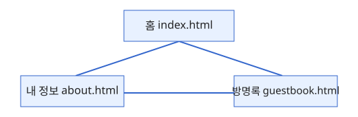
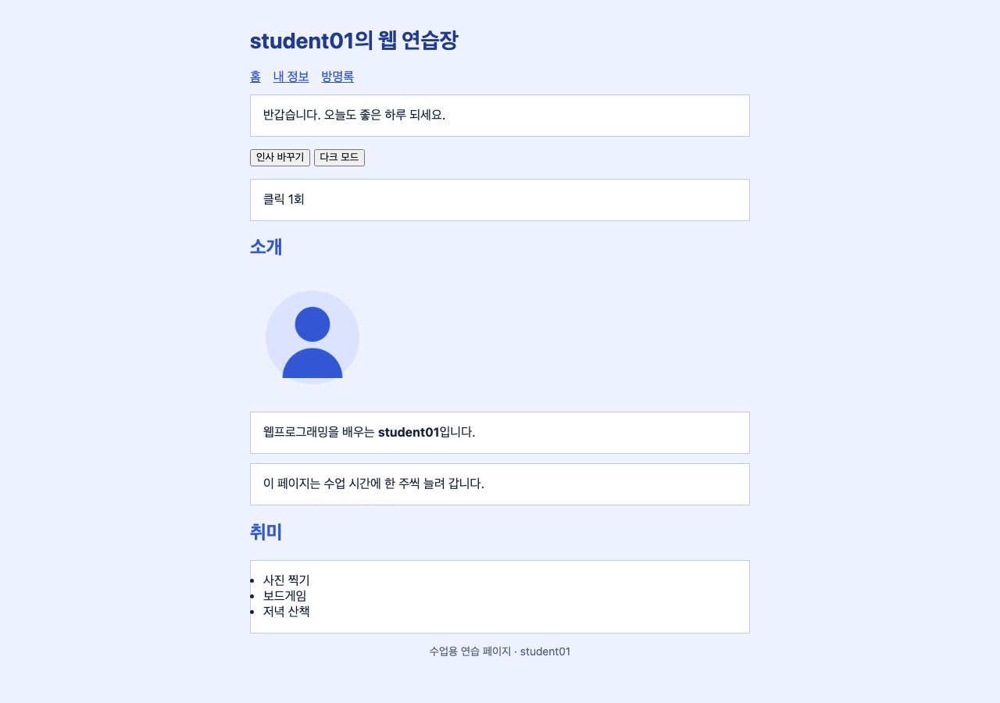
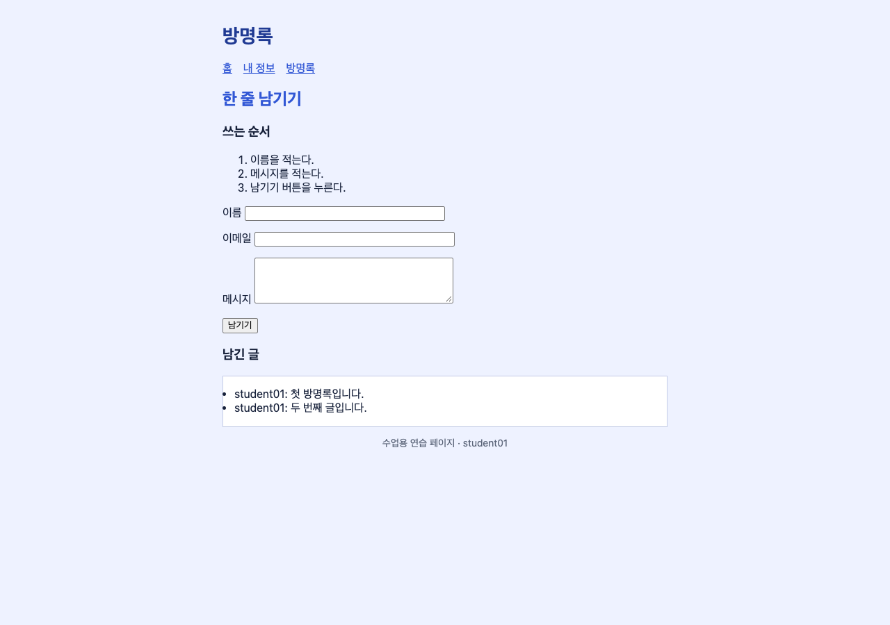

# kevindaebruyne의 웹 연습장

웹프로그래밍 수업에서 한 주씩 늘려 가는 **자기소개 사이트**입니다.

## 공개 주소

- [https://kevindaebruyne.github.io/11_04-assignment2/](https://kevindaebruyne.github.io/11_04-assignment2/)

## 페이지

| 페이지 | 파일 | 내용 |
|---|---|---|
| 홈 | [index.html](index.html) | 인사말, 소개, 취미 목록 |
| 내 정보 | [about.html](about.html) | 아이디·이메일·관심 분야 표 |
| 방명록 | [guestbook.html](guestbook.html) | 이름·메시지 폼 |



## 기능

- 홈의 "인사 바꾸기"와 "다크 모드" 버튼을 누르면 문장과 배경색이 바뀌고 클릭 횟수가 1씩 오릅니다.
- 방명록에서 이름과 메시지를 적고 "남기기"를 누를 때마다 아래 목록에 한 줄씩 쌓입니다. 빈칸이면 안내 문장이 나옵니다.

다크 모드 버튼은 `body` 에 class 하나를 붙였다 뗍니다.

```js
darkButton.addEventListener('click', function () {
  document.body.classList.toggle('dark');
  countUp();
});
```

## 화면





## 이번에 배운 것

이번 실습에서는 지난 시간에 배운 내용을 교수님께서 주신 방명록 프로젝트에 다시 적용해 보며 복습했습니다. 먼저 방명록 폴더를 깃허브 저장소로 초기화해서 이 폴더의 변경 사항을 깃이 관리할 수 있게 했고, 변경한 파일들을 커밋으로 묶어 저장한 다음 Publish 버튼으로 깃허브에 올렸습니다. 올릴 때는 교수님께서 결과물을 직접 확인하실 수 있도록 저장소를 비공개가 아닌 공개로 설정했습니다. 이어서 올린 방명록 페이지를 인터넷 주소로 접속할 수 있도록 페이지 주소를 만들었고, 그 주소로 들어가 홈, 내 정보, 방명록 페이지가 실제로 열리는지 확인했습니다. 마지막으로 이 주소를 README의 공개 주소 항목에 링크로 넣어, README에서 바로 눌러 사이트로 이동할 수 있게 했습니다. 이렇게 파일을 올리는 일부터 주소를 만들고 README에 연결하는 일까지 한 번 더 직접 해 보면서, 지난 시간에 배운 순서를 다시 익힐 수 있었습니다.
